# AutoWerke | IT: client portal and back office

A full-stack web app that runs a small IT consultancy end to end. Clients describe a problem in their own words. Claude drafts the requirements. The consultant reviews and prices them, then delivers phase by phase. The client signs off online, and an invoice and receipt follow, all in one place.

It was built for a real Microsoft 365 / Intune / Entra ID consultancy in Harare, Zimbabwe.

**[Live demo →](https://autowerke-it-demo.onrender.com/demo)** The real app on made-up data: sign in to the back office, track a sample project, and read every email it "sends". It runs on a free host, so the first visit can take about a minute to wake it.

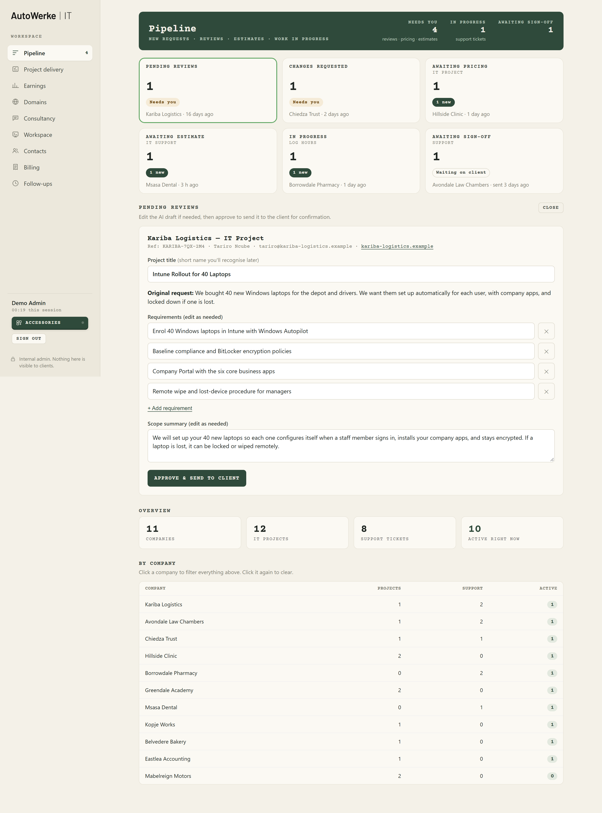

**Node.js + Express · Supabase (Postgres + private Storage) · Claude API · Resend · PDFKit / pdf-lib · plain HTML, CSS and JavaScript (no framework, no build step)**

---

## Try it in a minute

Use the [live demo](https://autowerke-it-demo.onrender.com/demo), or run it yourself. No accounts, keys or database needed: the demo runs the real server on made-up data held in memory.

```bash
npm install
npm run demo
```

| Open | What you'll see |
|---|---|
| http://localhost:3000/demo | Start here: sign-in details and an inbox of every email the app sends |
| http://localhost:3000 | The client site: choose a service and describe the problem |
| http://localhost:3000/track | Client tracking: try `KOPJEW-6TD-5LH` with `rudo@kopjeworks.example` |
| http://localhost:3000/admin | The back office: `demo@autowerke.example` / `Demo-Back-Office-2026`, then the 6-letter code from the `/demo` inbox (also printed in the terminal) |

Emails are captured instead of being sent: open them at `/demo`, PDFs included. AI drafting returns a canned draft unless you set `ANTHROPIC_API_KEY`. Restarting the demo resets the data, and so do 20 quiet minutes.

The hosted copy is the same command on Render's free tier ([`render.yaml`](render.yaml)). Because it's shared, emails to addresses a visitor typed stay hidden, and changing the password or the team is turned off.

---

## The flow

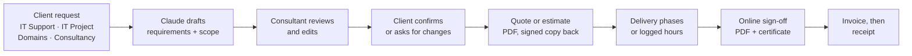

At every stage the client's private page shows whose move it is: "Ball's in our court" or "Ball's in your court". Each status has one owner and one plain-English description, defined in a single file (`public/status-info.js`) that both the server and the browser load.

## Screenshots

| | |
|---|---|
| 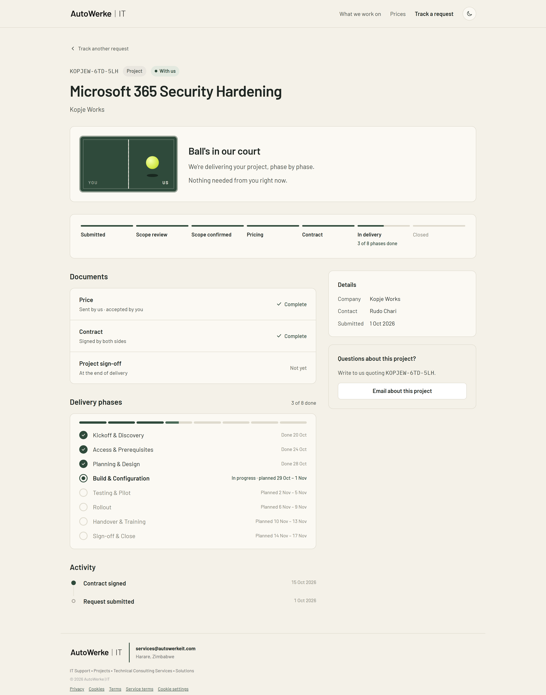 **Client tracking**: stages, documents, delivery phases and activity, with no login | 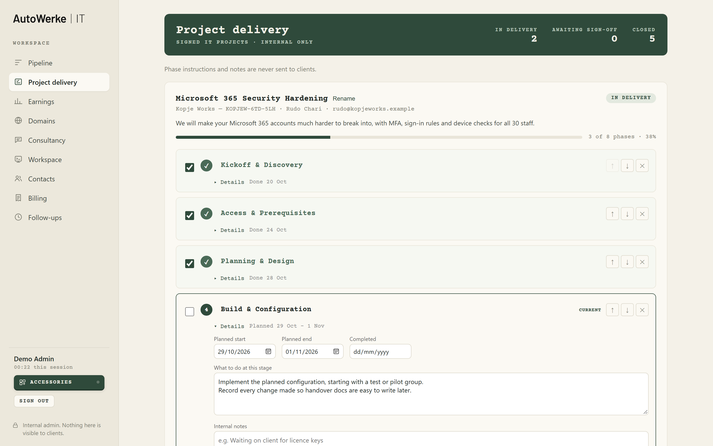 **Project delivery**: phases with internal-only instructions, dates and progress |
| 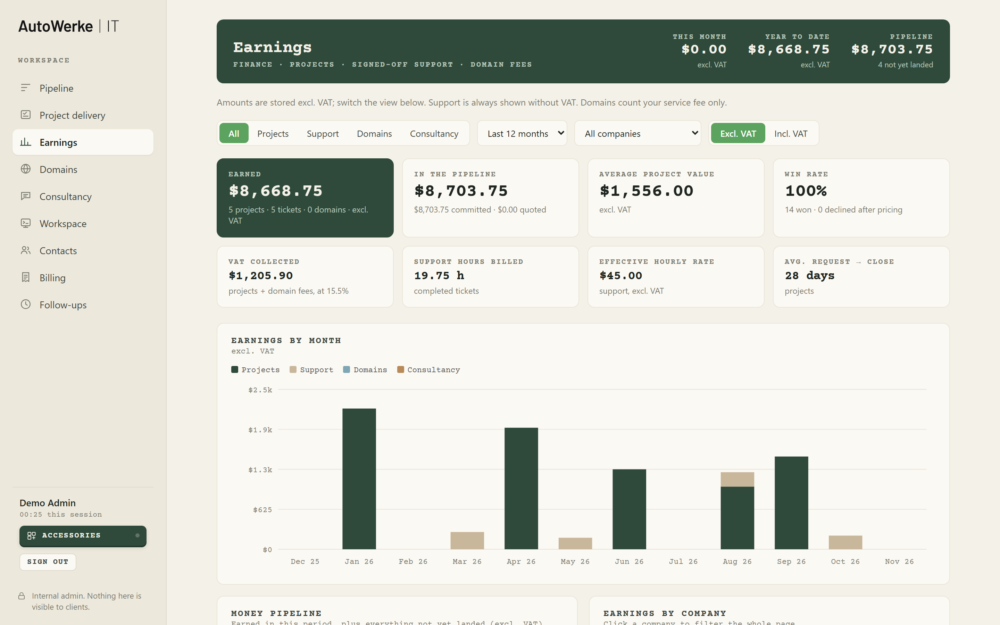 **Earnings**: earned vs pipeline, VAT, effective hourly rate, by month and company | 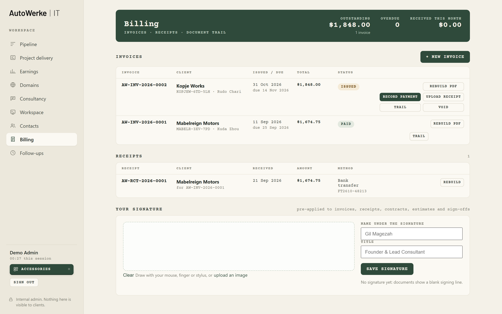 **Billing**: numbered invoices and receipts with a document trail |
| 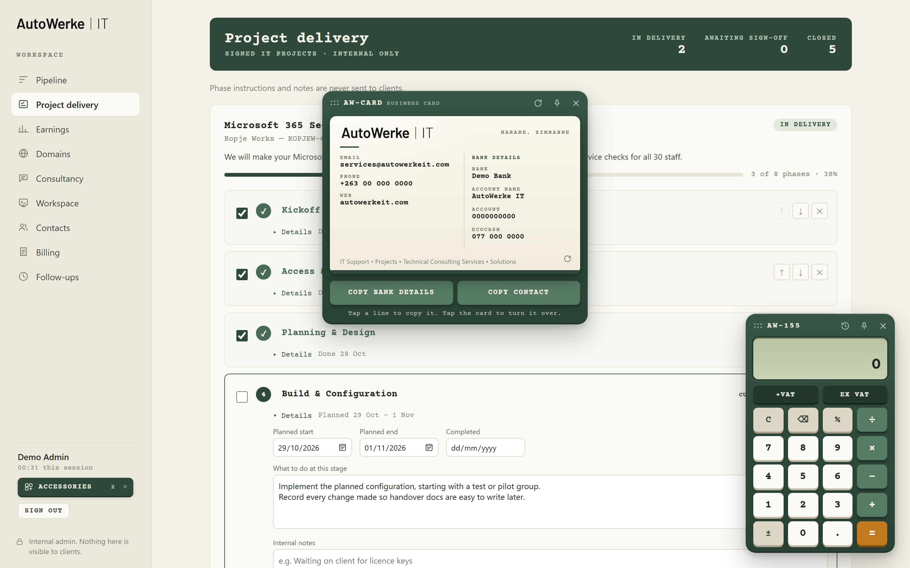 **Accessories**: VAT calculator, business card, Quick find (Ctrl+K), notes, timers | 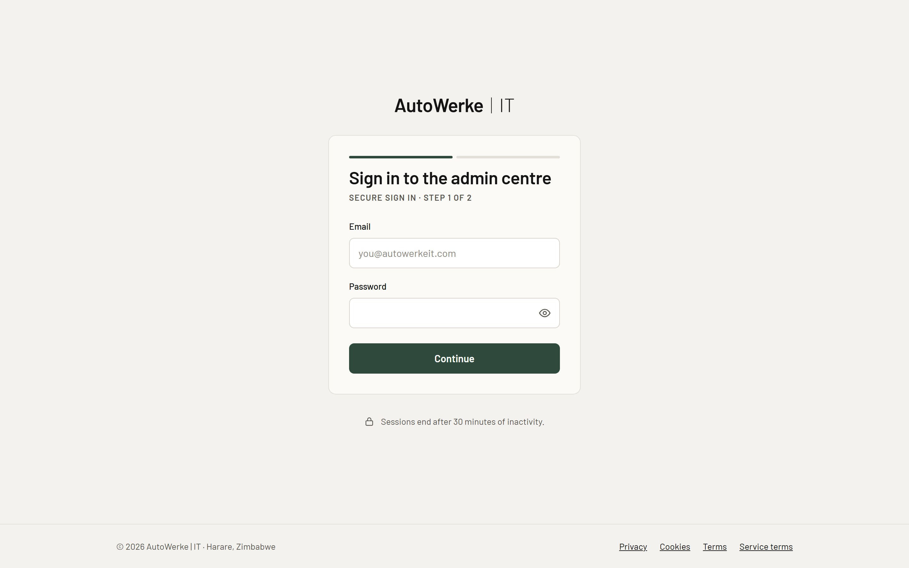 **Admin sign-in**: password, then a 6-letter emailed code |

<p>
  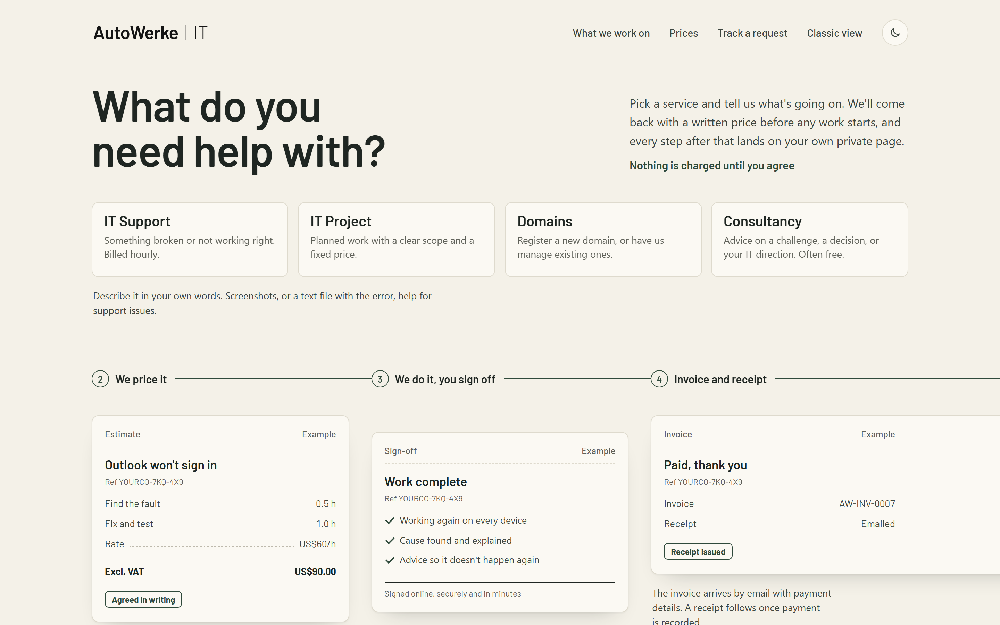
  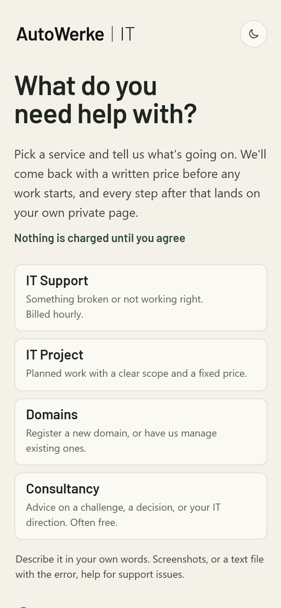
  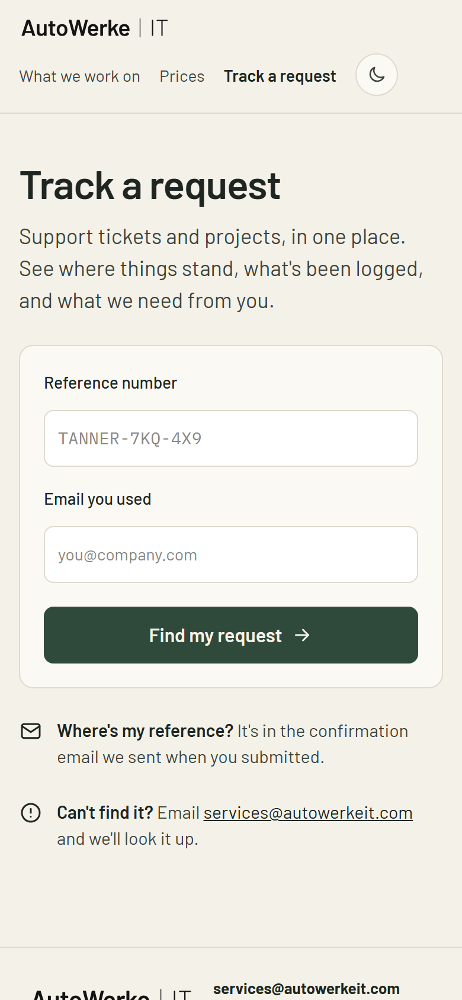
</p>

## What's in it

**For clients**
- One intake form for four services. It accepts screenshots and text files (error messages, logs), and its priority and impact questions feed the triage.
- A private tracking page per request. It shows stage, documents, delivery phases, time logged and activity, with no account needed.
- Online sign-off: identify, receive an 8-character code, sign. The result is a PDF plus a certificate of signature.
- Legal pages (privacy, cookies, terms, service terms) with recorded consent, and analytics that load only after opt-in.

**For the consultant (back office)**
- **Pipeline:** review AI drafts, handle change requests, send pricing and estimates, log hours.
- **Project delivery:** an editable phase template with internal notes that are never sent to clients, plus progress emails.
- **Earnings:** VAT-aware totals, pipeline value, win rate, effective hourly rate, and monthly and per-company charts.
- **Billing:** numbered invoices and receipts, recording payments, uploading external receipts, a pre-applied signature, and a document trail.
- **Also:** follow-ups and payment reminders, domain registry and renewals, consultancy replies drafted by Claude, contacts directory, a per-ticket workspace with encrypted secrets, and team access.
- **Accessories:** a draggable desk of small tools: calculator, Quick find, notes, support timer, password generator, world clock, currency converter, date maths and reminders, weekly debrief email, business card.

**Documents (PDFKit + pdf-lib)**
- Contract, work estimate, project and support sign-offs, invoice, receipt, contacts directory, and e-signature certificate.
- All share one house style: cover, contents, typewriter headings and invoice-style tables.

## Security

The security model is written down in [`DEVELOPMENT.md`](DEVELOPMENT.md#security-rules-keep-these) and checked by the test suites.

- **Admin sign-in:**
  - The password is hashed with scrypt.
  - The emailed one-time code is single-use, expires quickly and is attempt-limited.
  - Codes and session tokens are stored only as HMAC hashes and compared in constant time.
  - Resending a code needs a ticket from a correct password, and is limited to 3 resends, 45 seconds apart.
- **Strict CSP:** `script-src 'self'`, with no inline scripts or handlers anywhere. HSTS, a same-origin check on state-changing requests, and optional host isolation for the admin site (`admin.` subdomain).
- **Private storage bucket:** files are served through `/files/...` after an access check, as 60-second signed links. Uploads are checked by magic bytes, never by file name.
- **Workspace and registry secrets** are encrypted with AES-256-GCM and decrypted only on an explicit, logged Reveal. The value itself is never logged.
- **Stage guards:** client portal actions name the stages they're allowed from, so a stale link can't move a request backwards.
- **Rate limits** on sign-in, sign-off, intake, tracking and the portal. Portal links expire 30 days after a request is finished.
- **No probing:** found and not-found get identical responses. Public errors are generic, and client IPs come from `req.ip` with `trust proxy`, never from a client-written header.
- **Supabase row-level security** is locked down (`schema_rls.sql`). The service key never reaches the browser.

## Tests

```bash
npm test
```

19 end-to-end suites with 160+ checks. Each suite boots the real server in-process on its own port. It patches `lib/db.js` with an in-memory database, stubs storage, and intercepts `fetch` for Resend and Anthropic. That means the tests read the real one-time codes from captured emails and never touch a live service.

The suites are adversarial on purpose. They try:
- wrong, reused and expired codes
- cross-site requests and path traversal
- another client's token
- renamed executables posing as PDFs
- HTML and script injection in every field that gets rendered

The tests run on every push via GitHub Actions ([`.github/workflows/test.yml`](.github/workflows/test.yml)).

## Project structure

```
server.js            Wiring only (~160 lines): security headers → host routing → same-origin → private files → routers → errors
lib/                 Server modules
  *Routes.js           one router per area: public, pipeline, delivery, portal, billing, domains, consultancy, ...
  db.js                every database query (Supabase)
  auth.js, esign.js    admin sign-in and online sign-off
  security.js          hashing, codes, cookies, CSP, rate limits
  billing*.js          invoices and receipts      workspace.js   per-ticket workspace
  contract.js, estimate.js, signoff.js, ...        PDF documents
  email.js             every email, one sendEmail wrapper
views/               Admin pages (served only after sign-in)
public/              Client pages, admin scripts and styles (one HTML/JS/CSS set per page)
schema*.sql          Database setup, run in order (see below)
tests/               End-to-end suites + in-memory database
demo/                npm run demo: in-memory Supabase stand-in + made-up seed data
docs/                Build log (feature-by-feature history) and screenshots
DEVELOPMENT.md       Architecture, conventions, security rules and gotchas
```

## Running it for real

1. Copy `.env.example` to `.env` and fill it in. Every variable is explained there and in [`DEVELOPMENT.md`](DEVELOPMENT.md#environment-env-see-envexample).
2. In the Supabase SQL Editor, run the schema files in this order:
   - `schema.sql` → `schema_phase3.sql` → `schema_support.sql` → `schema_delivery.sql` → `schema_signoff.sql`
   - → `schema_closed.sql` → `schema_earnings.sql` → `schema_support_signoff.sql` → `schema_followups.sql` → `schema_services.sql`
   - → `schema_renewals.sql` → `schema_intake_extras.sql` → `schema_secure.sql` → `schema_billing.sql` → `schema_accessories.sql`
   - → `schema_website.sql` → `schema_rls.sql` (always last)
   - The app checks the schema at startup and names any file that hasn't been run.
3. `npm start`. Locally (over http), sign-in codes are also printed in the terminal; on an https site they never are.

The full step-by-step history, including email domain setup, deployment and every feature's design decisions, is in [`docs/BUILD-LOG.md`](docs/BUILD-LOG.md).

## How it was built

Built by Gil Magezah. [`DEVELOPMENT.md`](DEVELOPMENT.md) is a concise guide to the architecture, conventions, security rules and the bugs worth knowing about.

The legal pages are drafted for Zimbabwe's Cyber and Data Protection Act and South Africa's POPIA. They have **not** been reviewed by a lawyer.

## License

[PolyForm Noncommercial 1.0.0](LICENSE). You may read, run, change and share this code for any noncommercial purpose, such as personal use, study, research or a hobby project, as long as the `Required Notice` line goes with it. Commercial use is not allowed without written permission.

The licence covers the code only. The AutoWerke | IT name and logos are not licensed for any use.
